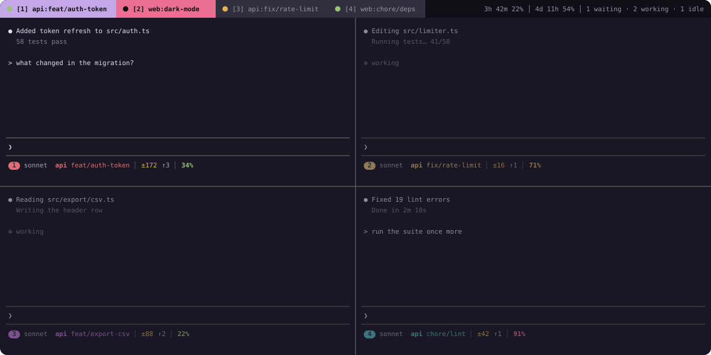
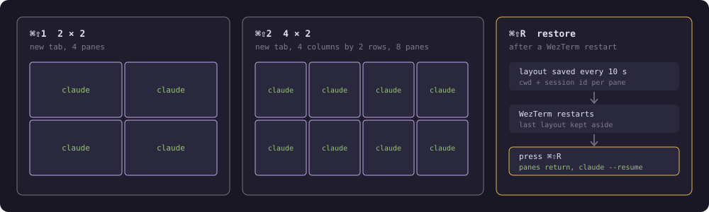
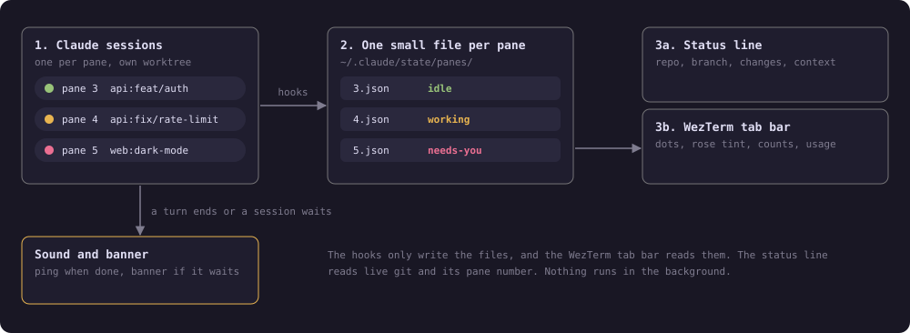

# wezterm-claude-kit

**Know which Claude session needs you, without opening every tab.**

Run several Claude Code sessions in WezTerm panes and see, at a glance, which one is working, which finished and which waits for you. The state shows in the tab bar and in each pane's status line. No background process, no extra window.



## What you get

- **Tab bar.** Each tab shows `repo:branch` and a dot for its busiest state. A tab that needs you turns rose. The right side shows how many sessions are waiting, working and idle, plus your 5-hour and 7-day usage. In a narrow window the counts become colored dots.
- **Status line per pane.** Model, repo, branch, changed lines (`±N`), commits ahead (`↑N`) and context percent (green, amber, rose). With several panes in a tab, each gets a numbered badge in its own color. It shortens itself to fit narrow panes and always keeps the context percent.
- **Sound and banner.** A ping when a turn ends. A different sound plus a macOS banner when a session needs you, only while WezTerm is not the frontmost app.
- **Dimmed inactive panes.** Your focused pane stays bright. `⌘⇧D` turns the dimming off and on.
- **Layouts.** One key opens a new tab with `claude` in every pane (2x2 or 4x2).
- **Restore.** After a WezTerm restart, one key brings back your panes and resumes each Claude session.

| Dot | Meaning |
| --- | --- |
| green | idle: the session finished its turn |
| yellow | working |
| rose tab | needs you: a permission prompt or a question |


## Hotkeys

Bound in `~/.wezterm.lua` (step 2 below).

| Keys | What it does |
| --- | --- |
| `⌘⇧D` | Dim or undim inactive panes |
| `⌘⇧1` | New tab, 2x2 panes, `claude` in each |
| `⌘⇧2` | New tab, 4 columns by 2 rows, `claude` in each |
| `⌘⇧R` | Restore the layout and sessions saved before the last restart |



## Quick start

You need macOS, [WezTerm](https://wezterm.org), [Claude Code](https://claude.com/claude-code), `jq` and `git`. Built and tested on WezTerm `20240203`.

**1. Install the hooks and status line.** This edits `~/.claude/settings.json` after saving a timestamped backup. Running it twice is safe.

```sh
git clone https://github.com/Khoa2001/wezterm-claude-kit.git
cd wezterm-claude-kit
bash install.sh
```

**2. Add the tab bar and hotkeys to `~/.wezterm.lua`.** Copy [`docs/wezterm.example.lua`](docs/wezterm.example.lua), or merge it into your config, and set the path to your clone. It has the tab handler, the hotkeys above and `tracker.setup(config)`.

**3. Restart your Claude sessions** so they load the hooks. WezTerm reloads its own config.

To remove everything, run `bash uninstall.sh`. It backs up `settings.json` again and removes only this kit's entries. Delete the lines you added to `~/.wezterm.lua` by hand.

## Settings

All optional. Set them in the `env` block of `~/.claude/settings.json` or in your shell profile.

| Variable | What it does |
| --- | --- |
| `SESSION_TRACKER_SOUND` | Sound file for a finished turn. Empty turns it off. Default: `Ping.aiff`. |
| `SESSION_TRACKER_SOUND_NEEDS` | Sound file when a session needs you. Empty turns it off. Default: `Glass.aiff`. |
| `SESSION_TRACKER_NOTIFY` | Set to empty to turn the macOS banner off. |
| `SESSION_TRACKER_PLAYER` | Program that plays sounds. Default: `afplay`. |

## Good to know

- **"Needs you" means a permission prompt or a question.** A turn that ends with a plain question in text looks idle.
- **Pressing Esc mid-turn** can leave a pane yellow until its next event.
- **The done sound plays for every pane**, even the one you look at. A hook cannot tell which pane has focus.
- **Usage shows `n/a`** when the numbers are older than 15 minutes.
- **Layouts open a new tab**, since WezTerm cannot reshape live panes. Restore opens new windows with even pane sizes; close WezTerm's empty startup window. Non-Claude panes come back as plain shells.
- **`install.sh` also adds three small hooks** that keep Claude's replies in the terse "ultracave" style: one flags a wordy reply, one reminds Claude on your next prompt, one nudges every 8th tool call (`SESSION_TRACKER_ULTRACAVE_EVERY`). `uninstall.sh` removes them.

## How it works



Claude Code runs a hook script on events such as a prompt, a tool call, a permission request and the end of a turn. The script writes one file per WezTerm pane, named after the pane's id. The tab bar reads them all. The status line shows live git and the context percent, and only needs its pane number from WezTerm. Every part fails quietly: if something goes wrong you see less, never a broken terminal.

<details>
<summary>Technical details</summary>

- **State file:** `~/.claude/state/panes/<WEZTERM_PANE>.json` with `{"state","repo","branch","cwd","session_id","ts","since"}`. States: `working`, `needs-you`, `idle`. `since` is when the pane entered its state. Files are wiped at WezTerm startup, because pane ids restart.
- **Hook events:** `UserPromptSubmit`, `PreToolUse`, `PostToolUse`, `PostToolUseFailure`, `PermissionRequest`, `Notification`, `Stop`, `StopFailure`, `SessionStart`, `SessionEnd`. Subagent events are ignored except permission prompts and notifications.
- **Status line:** `statusline/statusline-command.sh`. Git data is live; the ahead count compares with `origin`'s default branch and never runs `git fetch`. Pane width comes from the first parent process with a terminal, read with `stty`.
- **Pane numbers:** WezTerm writes `<WEZTERM_PANE>.pos` next to the state files while a tab has several panes.
- **Layout snapshot:** `~/.claude/state/layout.json`, written every 10 seconds when it changed and holds a Claude session. At startup it moves to `layout.prev.json`, which `⌘⇧R` reads.
- **Usage numbers:** read from `/tmp/.claude_usage_cache`, written by `~/.claude/fetch-usage.sh`, which is not part of this repo.
- **Tests:** `sh tests/run.sh` (needs `jq`, `git` and `luajit`).
- **Contributing:** see [`CLAUDE.md`](CLAUDE.md) for the architecture and rules that are easy to break, and [`docs/`](docs/) for the original design and plan.

</details>
